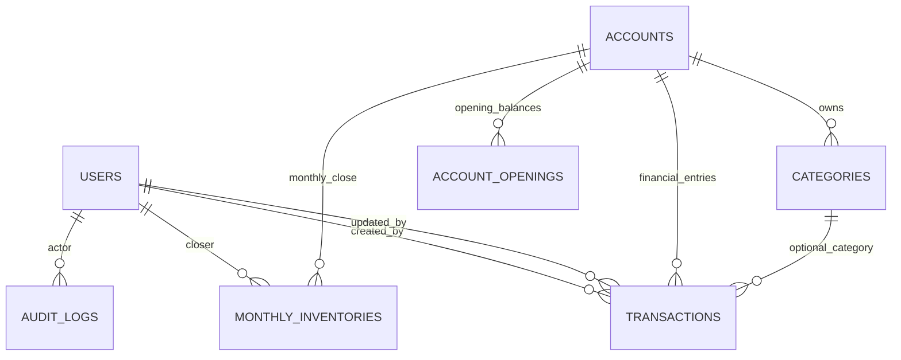

# Audit de schéma — Germe de David

## Tables et rôles

- `users` : comptes de connexion, rôle et statut.
- `settings` : paramètres clé/valeur.
- `accounts` : comptes financiers.
- `categories` : catégories liées à un compte ou catégories globales (`account_id` nullable).
- `account_openings` : solde initial par compte, année et devise.
- `transactions` : recettes/dépenses avec date, compte, devise, catégorie facultative et utilisateur auteur.
- `monthly_inventories` : clôture unique par compte/année/mois/devise.
- `audit_logs` : actions et historique.

## Relations

## Corrections apportées

1. Les scripts d'installation local et cloud sont harmonisés et les tables déclarent InnoDB/UTF-8. Le script cloud ne tente pas de créer/sélectionner une base, ce qui permet de l'exécuter dans une base déjà choisie depuis TiDB Cloud.
2. SSL/TLS de PDO est activé avec vérification du certificat côté serveur lorsque `DB_SSL=1`; le chemin du CA est configurable avec `DB_SSL_CA`. La configuration ne désactive plus la vérification TLS.
3. Les transactions peuvent sélectionner une catégorie. Le formulaire filtre les catégories selon le compte et le type; le serveur vérifie également l'association et le type, empêchant l'envoi d'une catégorie incompatible. Une catégorie reste facultative pour les anciennes écritures.
4. La page d'export ne répète plus le filtre recette/dépense.
5. `require_login()` recharge rôle et nom depuis la base à chaque requête protégée, afin que les changements de rôle soient appliqués sans attendre une nouvelle connexion.
6. Cookies de session HttpOnly, SameSite=Lax et Secure lorsque HTTPS est détecté.
7. Un index composé `(account_id, currency, tx_date)` est ajouté pour les agrégations/rapports par compte, devise et période. `tidb_upgrade.sql` contient l'ajout pour une base existante (à exécuter une seule fois).

## À noter / limites

- Les catégories peuvent être globales (`account_id IS NULL`) ou propres à un compte. Le script d'installation existant utilise des catégories propres aux comptes.
- Les clôtures sont protégées par une clé unique de compte/année/mois/devise. La base garantit l'unicité, même si deux requêtes de clôture concurrentes arrivent.
- `monthly_inventories` est une photographie de clôture, et non une table qui remplace les transactions.
- La base cloud n'a pas été testée en direct, faute de credentials/instance TiDB fournis. Les scripts ont été inspectés et les fichiers PHP passés au lint.
- Avant d'utiliser en production, tester les scénarios recette/dépense, catégorie, changement de rôle, clôture, export et restauration sur une copie.

## Installation TiDB Cloud (base neuve)

1. Sélectionner/créer la base `eglise_germe_de_david` dans le cluster.
2. Importer `install_cloud.sql` dans cette base.
3. Renseigner les variables d'environnement à partir de `.env.example` (sans versionner les secrets).
4. Vérifier `DB_SSL=1`, l'adresse CA, le port et la liste d'IP autorisées dans TiDB.
5. Déployer l'application PHP avec Docker; créer le compte admin via `setup_admin.php`, puis retirer/protéger ce script.

## Base existante

Faire un dump SQL complet, puis exécuter `tidb_upgrade.sql` une seule fois pour l'index supplémentaire. Ne pas relancer `install_cloud.sql` sur une base déjà peuplée.
